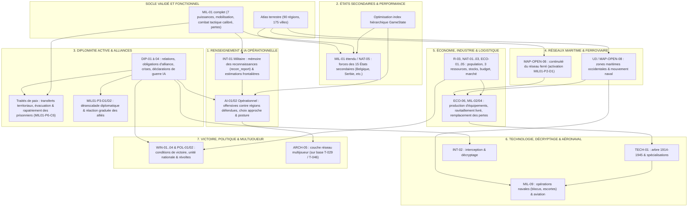

# Audit de transition post-MIL-01 et proposition de feuille de route

- **Date :** 16/11/2026
- **Branche :** `dev/mil01-finalisation`
- **Commit de référence audité :** `68b656c` (`68b656c51d8240370ad8ee6cc656792de86adfa1`, construit sur le commit principal de la phase 6 étape 3 `09617e8`)
- **CI de référence :** GitHub Actions run `43920595063` (`success`, 110 tests unitaires réussis, 0 échec, tests de fumée d'interface stratégique et tactique validés)
- **Statut du document :** **AUDIT TECHNIQUE ET PROPOSITION DE FEUILLE DE ROUTE.** Ce document dresse l'état réel du dépôt après l'achèvement de MIL-01 et propose un ordre de développement pour les prochaines phases. Aucune modification fonctionnelle n'a été apportée au code et aucune décision de conception n'est prise sans l'autorisation explicite du directeur du projet.

---

## Légende des états utilisés dans ce rapport

Conformément aux règles du projet, chaque fonctionnalité est qualifiée selon cinq niveaux strictement distincts :
- **D (Documenté)** : décrit dans la documentation de conception ou technique (`docs/`).
- **I (Implémenté)** : code réellement présent et exécutable dans `src/` ou `tools/`.
- **T (Testé)** : couvert par des tests automatisés dans `tests/` et exécutés en CI.
- **F (Fonctionnel en jeu)** : jouable et vérifié de bout en bout dans la boucle de jeu et l'interface (`src/ui/`).
- **P (Provisoire)** : implémenté avec des paramètres de conception ou des approximations historiques signalées, en attente de sources ou d'étalonnage complémentaire.
- **O / A (Ouvert / Absent)** : non tranché côté conception (`À DÉFINIR`) ou non implémenté dans le code (`null` ou structure vide).

---

## A. État réel du projet par grand système

### A.1 Vue synoptique des systèmes

| Système | Fichiers principaux (`src/` & `data/`) | État global | Niveau réel d'achèvement |
|---|---|---|---|
| **1. Militaire & Combat tactique (MIL-01, MIL-02, MIL-05 à 08)** | `src/domains/military/*`, `src/domains/combat/*`, `src/ai/tactical_ai.gd`, `data/history/military_forces_1914.json`, `data/rules/combat_rules.json`, `data/rules/forces_rules.json` | **D, I, T, F** (paramètres **P**) | **Achevé pour les 7 grandes puissances.** Effectifs sourcés, mobilisation par échelons/postures/allocations, Territorial Force, batailles tactiques en temps réel ou auto-résolues, 4 types d'engagement, largeur de front, rotations, comptabilité complète des pertes et prisonniers, calibration étape 3 validée. |
| **2. IA stratégique et de mobilisation (AI-01 à 05, T-052)** | `src/ai/nation_agent.gd`, `src/ai/mobilization_agent.gd`, `data/rules/ai_doctrines.json` | **D, I, T, P** (mobilisation) / **Partiel** (stratégie) | **Mobilisation autonome fonctionnelle (T-052).** En revanche, l'IA stratégique (`NationAgent`) est un **niveau 1 minimal** : elle ne déclare jamais la guerre, **n'attaque jamais une région défendue** (`enemy_presence.has(n)`), et utilise toujours l'approche par défaut (`assault`). |
| **3. Diplomatie, alliances et traités (DIP-01 à 05)** | `src/domains/diplomacy/diplomacy_system.gd`, `src/simulation/orders.gd` | **D, I, T** (structure & transit) / **O, A** (effets) | **Fondations structurelles uniquement.** Guerre, paix, propositions, ruptures, canaux de messages et mémoire existent, mais **seul le traité de passage (`transit`) et l'accès logistique allié ont un effet mécanique**. Les alliances n'entraînent pas d'entrée en guerre ; les clauses de paix et les échanges de prisonniers sont absents. |
| **4. Renseignement et reconnaissance (INT-01, INT-02)** | `src/domains/intelligence/intel_system.gd`, `src/domains/combat/battle_manager.gd` | **D, I, T** (vue filtrée) / **O, A** (collecte & décryptage) | **Cloisonnement anti-omniscience fonctionnel.** Chaque pays ne voit que ses régions et leurs voisines, sans l'effectif des armées étrangères (`soldiers = null`). Le rapport de reconnaissance tactique (`recon_report`) est généré mais **n'est pas réinjecté dans `IntelSystem`**. Aucun espionnage, interception ni décryptage. |
| **5. Économie, ressources et industrie (ECO-01 à 07)** | `src/domains/economy/economy_system.gd`, `data/rules/game_rules.json` | **D, I, T** (squelette) / **O, A** (données & effets) | **Non fonctionnel en jeu (affiché comme tel).** Squelette du modèle C implémenté et priorités des 5 catégories industrielles enregistrables, mais `resource_categories = []`, potentiels régionaux à `null`, aucun stock, aucun budget, aucun marché, aucune production d'équipement. |
| **6. Logistique et déplacements (MIL-03, MIL-04)** | `src/domains/logistics/logistics_system.gd`, `src/domains/military/military_system.gd` | **D, I, T, F** (continuité) / **O, A** (capacités & pénalités) | **Continuité territoriale fonctionnelle.** Calcul de connexion à la capitale (territoires alliés et détroits compris), détection d'encerclement (T-044) et résolution symétrique des déplacements simultanés (T-045). Portée fixe de 1 région/mois ; aucune capacité de transport ni pénalité de ravitaillement hors encerclement. |
| **7. Recherche et technologie (TECH-01)** | `src/domains/technology/research_system.gd` | **D** / **I** (coquille de 20 lignes) / **O, A** | **Absent en jeu.** Seule une classe utilitaire de 20 lignes (`new_project`, `advance`) existe. Aucun catalogue technologique (1914–1945), aucun ordre, aucun effet. |
| **8. Carte, infrastructures et données nationales (MAP, NAT)** | `src/map/world_map.gd`, `data/world/map/*`, `data/game/world_map.json`, `tools/map/*` | **D, I, T, F** (terrestre) / **Incomplet** (mer Ouest, rail, NAT) | **Atlas terrestre de 90 régions et 175 villes validé et reproductible.** Manquent : les zones maritimes occidentales (26 façades côtières orphelines), la continuité du réseau ferré (17 composantes disjointes), la population et les 12 statistiques nationales (`null`). |
| **9. Interface et expérience de jeu (UX-01, UX-02)** | `src/ui/main.gd`, `src/ui/map_view.gd`, `src/ui/game_ui.gd`, `src/ui/battle_view.gd` | **D, I, T, F** | **Fonctionnelle et testée.** Menu, carte interactive (zoom, hachures d'occupation, figurines, flèches d'ordres), panneau à 10 onglets, vue tactique temps réel et mode préparation des défenses. |
| **10. Sauvegardes, stabilité et multijoueur (ARCH-01 à 06, T-046)** | `src/simulation/game_state.gd`, `src/simulation/turn_resolver.gd`, `src/adapters/save_repository.gd` | **D, I, T, F** (solo) / **Préparé** (multijoueur) | **Robuste et déterministe.** Format de sauvegarde v4 avec empreintes SHA-256 et migration v3→v4. Règles multijoueur (commandement conjoint, pause unanime, déconnexion T-046) implémentées dans la simulation, mais **aucune couche réseau**. |

---

### A.2 Examen détaillé domaine par domaine

#### 1. Système militaire et combat tactique (`MIL-01`, `MIL-02`, `MIL-05` à `MIL-08`)
- **Fonctionnalités terminées (`D, I, T, F`) :**
  - Base historique sourcée des 7 puissances jouables en 1914 (`data/history/military_forces_1914.json`) et fiches nationales générées automatiquement (`docs/history/fiches/*.md`).
  - Mobilisation progressive par postures (`paix`, `preparatoire`, `generale`), échelons historiques documentés (Allemagne, Autriche-Hongrie) ou bloc unique signalé comme approximation (`MIL01-P1-D1`), allocation des moyens (administration, rail, logistique), blocage des réservistes en territoire occupé sans voie de communication terrestre amie ou alliée (`T-056 bis`).
  - Territorial Force britannique (`T-050`, `T-054`) en catégorie distincte, service intérieur par défaut et volontariat outre-mer.
  - Résolution symétrique des déplacements simultanés sans biais d'ordre (`T-045`) et croisement sans bataille.
  - Moteur tactique complet (`Battlefield`, `BattleManager`, `TacticalSim`, `TacticalOrders`, `TacticalAI`, `DefenseSystem`, `Engagement`, `BattleResult`) : choix d'approche offensive (`reconnaissance`, `limited_attack`, `assault`) et de posture défensive (`delay`, `hold`, `hold_at_all_costs`), 4 types d'engagement (`skirmish`, `limited`, `frontal`, `major`), largeur de front dynamique et rotations en ligne, tir de contre-batterie, écrantage, rupture de combat, effondrement de défense intenable.
  - Comptabilité nationale rigoureuse (`ForceLedger`) : tués, blessés légers maintenus dans l'unité (à 50 % d'efficacité pendant 1 mois), blessés en convalescence (1 ou 3 mois), retours au service (55,6 %), inaptes définitifs (17 %), convalescence de longue durée (~27,4 %), disparus, prisonniers détenus et perdus, traitement ordinaire de la déroute pour tout camp conservant le terrain (vainqueur ou défenseur en bataille indécise, unités anéanties comprises).
- **Fonctionnalités partiellement développées ou provisoires (`P`) :**
  - Répartition territoriale par district de corps et ventilation par arme estimées (signalées dans les données) ; armée ottomane sans ventilation par arme sourcée.
  - Retard ferroviaire de mobilisation neutralisé à `0` (`rail_gap_months = 0`, décision `MIL01-P2-D1`) en attendant la fiabilisation du graphe ferroviaire.
- **Fonctionnalités absentes (`O / A`) :**
  - **Forces des 15 États secondaires européens** (Belgique, Serbie, Roumanie, Bulgarie, Grèce, Monténégro, Albanie, Pays-Bas, Suisse, Espagne, Portugal, Danemark, Suède, Norvège, Luxembourg) : un seul emplacement d'armée avec `soldiers: null` et aucune unité.
  - Création libre de nouvelles formations, entraînement, production d'équipement, remplacement des pertes définitives dans les unités existantes et démobilisation (`MIL-02`).
  - Cours d'eau, ponts et cols représentés individuellement sur le champ de bataille tactique (le terrain tactique utilise actuellement la moyenne régionale de relief).
  - Marine et aviation (`MIL-09`).
- **Tests disponibles :** 79 tests unitaires dédiés (`test_forces_mil01.gd`, `test_mobilization_phase2.gd`, `test_ai_mobilization.gd`, `test_territorial_force.gd`, `test_casualty_accounting.gd`, `test_combat.gd`, `test_engagements.gd`, `test_moves_t045.gd`, `test_disconnect_t046.gd`, `test_campaign_integration.gd`) + `battle_ui_smoke.gd`.

#### 2. Intelligence artificielle stratégique et diplomatique (`AI-01` à `AI-05`, `T-052`)
- **Fonctionnalités terminées (`D, I, T, F`) :**
  - Cloisonnement strict : `NationAgent.decide` et `MobilizationAgent.decide` ne reçoivent que `IntelSystem.view_for(state, world, nid)` et n'accèdent jamais à `GameState` ni aux ordres secrets ou volumes cachés adverses (vérifié par tests).
  - `MobilizationAgent` (`src/ai/mobilization_agent.gd`) : évaluation déterministe de la menace perçue, adoption des postures selon les doctrines nationales (`data/rules/ai_doctrines.json`), appel de l'échelon suivant, réallocation logistique en cas d'occupation ou de blocage, désescalade hors guerre.
  - `TacticalAI` (`src/ai/tactical_ai.gd`) : conduite complète des batailles tactiques sous brouillard de guerre, choix des objectifs, écrantage, contre-batterie, charges limitées, gestion des réserves et renforts.
- **Fonctionnalités partiellement développées (`I, P`) :**
  - Dans `NationAgent` (`src/ai/nation_agent.gd`) :
    - Réponse binaire aux propositions de traités selon la mémoire d'hostilité (`treaty_broken`, `declared_war`) et le statut d'allié.
    - Proposition automatique de paix si au moins une région nationale est occupée par l'ennemi (`_occupies_my_regions`).
    - En guerre : maintien sur place si une armée ennemie est adjacente (`lines 131-133`), ou déplacement vers une région ennemie voisine **uniquement si elle est non défendue** (`not enemy_presence.has(n)`, `line 139`).
- **Fonctionnalités absentes (`O / A`) :**
  - **Aucune offensive contre une région défendue :** `NationAgent._war_target` exclut toute région contenant une formation ennemie (`enemy_presence.has(n)`). Par conséquent, deux IA en guerre ne déclenchent jamais de bataille tactique sur une frontière gardée (par exemple la frontière franco-allemande en Lorraine).
  - **Aucun choix d'approche offensive ni de posture défensive par l'IA stratégique :** `NationAgent._military` appelle `Orders.move(me, f["id"], target)` sans argument `approach` (toujours `assault` par défaut) et n'émet jamais `Orders.defensive_posture`.
  - **Aucune initiative diplomatique offensive ou préventive :** pas de déclaration de guerre par l'IA, pas de proposition d'alliance, de transit ou de coalition, pas d'évaluation des rapports de force ni des objectifs géopolitiques (`AI-01`, `AI-02`).
  - **Correction de la spirale d'escalade (`MIL01-P3-D1`) et réaction graduée à la guerre d'un allié (`MIL01-P3-D2`) :** reportées explicitement à la phase diplomatie/IA stratégique.
- **Tests disponibles :** `test_ai_mobilization.gd` (8 tests), `test_rules.gd` (`test_ai_view_is_not_omniscient`, `test_ai_defends_and_counterattacks`), `test_combat.gd` (`test_ai_respects_fog`).

#### 3. Diplomatie, négociations, alliances et traités (`DIP-01` à `DIP-05`)
- **Fonctionnalités terminées (`D, I, T, F`) :**
  - Structures d'ordres et résolution simultanée dans `DiplomacySystem` (`src/domains/diplomacy/diplomacy_system.gd`) : `declare_war`, `propose_treaty` (`alliance`, `transit`, `trade`, `guarantee`, `coalition`, `peace`), `respond_proposal`, `break_treaty`, `send_message` (canaux `public`, `private`, `group`).
  - Mémoire diplomatique enregistrée dans `state.memory` (`declared_war`, `proposal_accepted`, `proposal_rejected`, `treaty_signed`, `treaty_broken`).
  - Effet réel du traité de `transit` sur `MilitarySystem.validate_move` et du traité d'`alliance` sur la continuité logistique (`LogisticsSystem.friendly`) et le transit des réservistes (`MobilizationSystem`).
- **Fonctionnalités partiellement développées (`I, O`) :**
  - Les traités de départ de 1914 (`t_dual_alliance`, `t_franco_russian`, `t_entente_cordiale`, `t_triple_alliance`) sont présents dans `campaign_1914.json`, mais avec `"terms": null` et `"terms_status": "OUVERTE (DIP-02)"`.
- **Fonctionnalités absentes (`O / A`) :**
  - **Obligations d'alliance (*casus foederis*) et garanties :** déclarer la guerre à un membre d'une alliance n'entraîne ni entrée en guerre automatique ni appel aux alliés.
  - **Échelle de relations et d'intérêts (`DIP-01`, `R-07`) :** aucune valeur de relation ni d'affinité/rivalité n'existe entre États.
  - **Crises diplomatiques et violation de souveraineté :** tenter d'entrer sans autorisation en territoire neutre est simplement bloqué par l'interface/validation au lieu de pouvoir déclencher une crise ou une guerre.
  - **Règlement de paix et transfert territorial (`DIP-04`) :** accepter la paix (`kind == "peace"`) supprime l'entrée de `state.wars`, mais laisse les régions occupées sous le contrôle militaire de l'occupant sans transfert de souveraineté ni évacuation des armées !
  - **Prisonniers de guerre et diplomatie (`MIL01-P6-C6`) :** aucun mécanisme d'échange de prisonniers, de libération négociée ni de rapatriement à la signature de la paix (les prisonniers restent indéfiniment dans `prisoners_held` / `prisoners_lost`).
- **Tests disponibles :** `test_rules.gd` (`test_foreign_entry_requires_war_or_transit`, `test_transit_treaty_grants_passage`, `test_diplomacy_memory_and_break`).

#### 4. Renseignement, espionnage et reconnaissance (`INT-01`, `INT-02`)
- **Fonctionnalités terminées (`D, I, T, F`) :**
  - `IntelSystem.view_for` (`src/domains/intelligence/intel_system.gd`) filtre la carte stratégique : un pays observe ses régions contrôlées et leurs voisines directes (terre et détroits), voit la présence d'armées étrangères dans ces régions mais avec `"soldiers": null`, et reçoit `public_mobilization` (postures et échelons ouverts, sans volumes, `T-056`).
  - En bataille tactique, brouillard de guerre complet avec portée de détection, dissimulation selon le terrain et la formation, et mémoire vieillissante (`fog[side]`).
  - Lorsqu'un attaquant mène une bataille en approche `reconnaissance`, `BattleManager.finish` produit un rapport `b["recon_report"]` (`units_seen`, `estimate`, `fortification_level`).
- **Fonctionnalités absentes (`O / A`) :**
  - **Exploitation stratégique de la reconnaissance (`recon_report`) :** le rapport `b["recon_report"]` est affiché dans la fenêtre de résultat tactique, mais n'est **pas stocké dans la mémoire de renseignement du pays (`state.memory` ou structure dédiée)** et n'est **pas exposé dans `IntelSystem.view_for`**. Ni le joueur sur la carte stratégique (onglet `Renseignement`), ni l'IA stratégique (`NationAgent`) ne peuvent consulter les estimations d'effectifs et de fortifications obtenues par reconnaissance.
  - **Fraîcheur et vieillissement des rapports stratégiques (`MAP-DEC-56`, `MAP-DEC-65`, `MAP-OPEN-17`) :** non implémentés à l'échelle stratégique.
  - **Renseignement sur les volumes de mobilisation (`Q3`), renseignement économique/technologique, interception et décryptage des messages privés/ordres (`INT-01`, `INT-02`, `R-09`) :** absents.
- **Tests disponibles :** `test_rules.gd` (`test_ai_view_is_not_omniscient`), `test_mobilization_phase2.gd` (`test_public_information_without_volumes`), `test_ai_mobilization.gd` (`test_ai_uses_only_accessible_information`).

#### 5. Économie, ressources, industrie et logistique (`ECO-01` à `ECO-07`, `MIL-03`, `MIL-04`)
- **Fonctionnalités terminées (`D, I, T, F`) :**
  - `LogisticsSystem` (`src/domains/logistics/logistics_system.gd`) : calcul par parcours en largeur des régions accessibles depuis la capitale (`accessible_regions`) à travers les régions contrôlées par le pays ou un allié ; mise à jour mensuelle de `f["supplied"]` et journalisation des armées coupées ; encerclement mensuel, attrition et capitulation dans `BattleManager.monthly_encirclement` (`T-044`).
  - `EconomySystem` (`src/domains/economy/economy_system.gd`) : validation et enregistrement de l'ordre `SET_INDUSTRY_ALLOCATION` sur les 5 catégories industrielles validées (`industrie_militaire_terrestre`, `industrie_aeronautique`, `industrie_navale`, `industrie_civile`, `munitions_et_equipements`) ; propagation stricte de `null` pour toute valeur inconnue.
- **Fonctionnalités absentes (`O / A`) :**
  - **Catégories de ressources (`R-03`, `ECO-01`) :** `game_rules.json` contient `"resource_categories": []` (les 3 ressources de `docs/economy/OVERVIEW.md` — nourriture, matières premières, richesse — ne sont pas encore activées dans `game_rules.json`).
  - **Données économiques régionales et nationales (`ECO-02`) :** dans `campaign_1914.json`, chaque région a `potential: {}`, `exploitation_capacity: null`, `infrastructure_level: null`, et chaque nation a `stocks: {}`.
  - **Consommation, pénuries, marché, contrats commerciaux et budget (`ECO-03` à `ECO-05`) :** absents.
  - **Production industrielle réelle et coûts militaires (`ECO-06`, `Q1`, `Q2`, `R-03` des ouvrages) :** les priorités industrielles, la mobilisation et la construction de tranchées/installations n'ont aucun coût ni rendement matériel.
  - **Capacités de transport logistique (`delivered`) et pénalités de ravitaillement hors encerclement (`MIL-04`) :** `delivered` vaut toujours `null` ; une armée non encerclée mais coupée de sa capitale (`supplied == false`) ne subit encore aucune pénalité de combat ou de mouvement.
- **Tests disponibles :** `test_rules.gd` (`test_logistics_cut_off`, `test_economy_unknowns_propagate`), `test_combat.gd` (`test_retreat_and_encirclement_outcomes`, `test_encircled_army_keeps_fighting`).

#### 6. Recherche et évolution technologique (`TECH-01`)
- **État réel :** seule existe `src/domains/technology/research_system.gd` (20 lignes : `new_project`, `advance`), qui n'est appelée par aucun autre fichier du projet. L'onglet `Recherche` de `GameUI` affiche explicitement `NON FONCTIONNEL — l'arbre technologique (1914–1945) n'est pas défini`.
- **Tests disponibles :** aucun test unitaire dédié (seule la construction de l'onglet est vérifiée par `ui_smoke.gd`).

#### 7. Carte, régions, infrastructures et données nationales (`MAP`, `NAT`)
- **Fonctionnalités terminées (`D, I, T, F`) :**
  - Géométrie et topologie terrestre des **90 régions** (184 arêtes terrestres, 10 + 3 traversées de détroits) validées et reconstructibles octet pour octet (`tools/map/validate_all.sh --full`).
  - 16 zones maritimes existantes (Nord, Baltique, Méditerranée orientale, mer Noire, Caspienne) géométriquement valides en EPSG:3035 et 67 liens région-zone catalogués (lot 2).
  - 175 villes rattachées et validées (`cities.json`), relief régional (`terrain.json`).
  - Pipeline d'export `tools/export/build_game_data.py` → `data/game/world_map.json` vérifié en CI.
- **Fonctionnalités incomplètes ou absentes (`O / A`) :**
  - **Mers occidentales absentes (`U3` / `MAP-OPEN-08`) :** aucune zone maritime ne couvre la Manche, la mer du Nord occidentale, la mer d'Irlande, l'Atlantique, Gibraltar, la Méditerranée occidentale, la Tyrrhénienne ni l'Adriatique Nord (26 façades côtières orphelines ; réseau maritime scindé en 3 composantes disjointes).
  - **Réseau ferroviaire fragmenté (`MAJ-002` / `MAP-OPEN-06`) :** `infrastructure.json` compte **17 composantes connexes disjointes** (41 villes non reliées), ce qui empêche son utilisation directe pour la logistique ou la mobilisation (`MIL01-P2-D1`).
  - **Données démographiques et statistiques nationales (`NAT-01` à `NAT-03`, `R-05`) :** `population.value = null` et les 12 statistiques nationales (`population_totale`, `industrie`, `economie`, etc.) valent `null` pour les 22 États dans `campaign_1914.json`.
  - **Rendu cartographique :** le relief régional (`relief_categories`), les fleuves et les voies ferrées ne sont pas encore dessinés sur `MapView` (`src/ui/map_view.gd`).
- **Tests disponibles :** `test_world_and_state.gd`, validateurs Python (`validate_geometry.py`, `validate_topology.py`, `validate_thematic.py`, `validate_atlas.py`, `build_game_data.py --check`, `build_scenario.py --check`).

#### 8. Interface et expérience de jeu (`UX-01`, `UX-02`)
- **Fonctionnalités terminées (`D, I, T, F`) :**
  - Menu principal (`src/ui/main.gd`) avec choix de la puissance (7 puissances jouables), choix du scénario (`campaign_1914` fixé à janvier 1914 selon `T-057`, ou `sandbox_fictif` à mois libre) et chargement de sauvegarde.
  - Carte stratégique (`src/ui/map_view.gd`) et panneau latéral à 10 onglets (`src/ui/game_ui.gd`).
  - Vue tactique (`src/ui/battle_view.gd`) pour les batailles jouées et la préparation mensuelle des défenses hors bataille, vérifiée aux résolutions **1214×955** et **1600×900**.
- **Limites connues :**
  - Choix de l'approche offensive via un sélecteur global pour les prochains ordres de déplacement (affiché clairement dans chaque ordre préparé), plutôt qu'une boîte de dialogue par flèche.
  - Chargement limité au bouton « Charger la dernière sauvegarde » (pas encore de liste de sélection de fichier ni de suppression dans l'interface).
  - Absence de mini-carte tactique et de calques visuels (relief, rail, ravitaillement) sur la carte stratégique.
- **Tests disponibles :** `tests/ui_smoke.gd` et `tests/battle_ui_smoke.gd` (exécutés à chaque `bash tests/run.sh`).

#### 9. Sauvegardes, stabilité, performance et multijoueur (`ARCH-01` à `06`, `T-046`)
- **Fonctionnalités terminées (`D, I, T, F`) :**
  - Sérialisation complète et déterministe de `GameState` (format v4), enveloppe `SaveRepository` vérifiant le format, la version des règles, l'empreinte `world_sha256` et l'empreinte `state_sha256` canonique.
  - Migration sûre et testée des sauvegardes de format 3 vers le format 4 (`ForceLedger.migrate_state`).
  - Sauvegarde et rechargement possibles **en plein milieu d'une bataille tactique active** avec reprise strictement identique au pas près (`test_reproducibility_and_save_mid_battle`).
  - Fondations multijoueur dans la simulation : ordres JSON rejouables, commandement conjoint (`T-029`), pause unanime, gestion des déconnexions/reconnexions et du délai de grâce avec relais par l'IA tactique (`T-046`, `test_disconnect_t046.gd`).
- **Limites connues :**
  - Aucune couche réseau (transport, salon, synchronisation client/serveur, détection de déconnexion hors bataille).
  - Coût algorithmique de `GameState.descendants()` (voir §B.6 ci-dessous).

---

## B. Problèmes techniques ou de conception et dépendances bloquantes

L'examen croisé du code source met en évidence **sept verrous critiques** qui expliquent pourquoi, bien que le système militaire `MIL-01` soit complet et équilibré, le jeu ne permet pas encore de dérouler une campagne historique complète de 1914.

### B.1 Verrou 1 — Passivité offensive et cécité de l'IA stratégique (`src/ai/nation_agent.gd` & `src/domains/intelligence/intel_system.gd`)

Dans `src/ai/nation_agent.gd` (lignes 130–147), la fonction `_war_target` contient deux règles héritées du prototype initial :
1. **Ligne 131–133 :** si une formation ennemie est présente dans une région voisine (`enemy_presence.has(n)`), l'armée de l'IA reste sur place (`return ""`).
2. **Ligne 139 :** lorsqu'elle cherche une cible à attaquer, elle ignore toute région où se trouve une formation ennemie (`if not enemies.has(owner) or enemy_presence.has(n) or claimed.has(n): continue`).

**Conséquence directe :** dans une partie en campagne, **l'IA stratégique n'attaque jamais une région défendue**. Deux IA en guerre (ou une IA face au joueur qui garnit sa frontière) se contentent de mobiliser leurs réserves et de se regarder sans jamais déclencher une seule bataille tactique, sauf si deux armées marchent simultanément vers la même région vide !

De plus, même si l'on retire ce blocage dans `NationAgent._war_target`, un second obstacle apparaît immédiatement dans `IntelSystem.view_for` (`src/domains/intelligence/intel_system.gd`, ligne 30) :
- Pour toute formation étrangère visible, `"soldiers"` vaut `null`.
- Le rapport `b["recon_report"]` produit par les reconnaissances en force de `MIL-01` (`BattleManager.finish`) est stocké uniquement dans `state.battles[-1]` et **n'est jamais transmis à `IntelSystem.view_for`**.
- **Dépendance :** pour que l'IA stratégique puisse choisir intelligemment entre `reconnaissance` (quand la force ennemie est inconnue), `limited_attack` et `assault` (quand l'effectif ennemi estimé est inférieur au sien), ou adopter la posture `delay` / `hold` / `hold_at_all_costs`, **`IntelSystem` doit d'abord mémoriser et exposer les estimations de renseignement militaire (avec leur date de fraîcheur) issues de l'observation frontalière et des reconnaissances en force.**

### B.2 Verrou 2 — Absence d'effets mécaniques des alliances, de déclenchement de guerre et de règlement de paix (`src/domains/diplomacy/diplomacy_system.gd`)

1. **Alliances inactives au déclenchement d'une guerre :** dans `DiplomacySystem.resolve`, l'ordre `DECLARE_WAR` ajoute une guerre bilatérale `{a, b}` sans déclencher aucune réaction des alliés (`t_dual_alliance`, `t_franco_russian`, `t_triple_alliance`, `t_entente_cordiale`).
2. **Absence d'initiative de guerre de l'IA :** `NationAgent` ne génère jamais d'ordre `DECLARE_WAR`. En commençant en janvier 1914 (`T-057`), aucune guerre n'éclate jamais si le joueur n'en déclare pas lui-même une à chaque belligérant.
3. **Spirale d'escalade de mobilisation (`MIL01-P3-D1` et `MIL01-P3-D2`) :** comme documenté en phase 3 de MIL-01, deux blocs rivaux mobilisés restent bloqués indéfiniment en mobilisation générale faute de mécanisme de désescalade diplomatique, et la guerre d'un allié donne immédiatement +30 points de menace (suffisant pour déclencher la mobilisation générale au lieu d'une réaction graduée).
4. **Paix blanche sans règlement territorial ni rapatriement des prisonniers (`DIP-04`, `MIL01-P6-C6`) :** signer la paix dans `DiplomacySystem._respond` retire simplement l'entrée de `state.wars`, laissant les régions occupées sous occupation perpétuelle, les armées en territoire étranger bloquées sans droit de passage, et les prisonniers de guerre (`prisoners_held` / `prisoners_lost`) détenus à jamais.

### B.3 Verrou 3 — États secondaires européens sans effectifs (`soldiers: null`) et repli neutre (`src/simulation/turn_resolver.gd`)

Dans `data/scenarios/campaign_1914.json` (généré par `tools/export/build_scenario.py`), seuls les 7 grands pays jouables ont reçu des forces historiques dans le cadre de `MIL-01`. Les **15 autres États européens** — dont des belligérants centraux de 1914 comme la **Serbie**, la **Belgique**, le **Monténégro**, la **Roumanie**, la **Bulgarie** et la **Grèce** — possèdent uniquement une formation `"Armée nationale"` à leur capitale avec `"soldiers": null` et aucune unité subordonnée.

Or, dans `TurnResolver.resolve` (`src/simulation/turn_resolver.gd`, lignes 57–64) :
- Lorsqu'une armée attaque une région contenant une formation dont `soldiers` vaut `null`, `BattleManager.create` renvoie `{}` et l'affrontement bascule dans `BattleSystem` (`neutral_no_outcome`).
- Le résolveur neutre clôt l'affrontement sans bataille, sans pertes, et **renvoie l'attaquant dans sa région d'origine**.
- **Conséquence bloquante :** dans la campagne historique actuelle, la région de la capitale d'un État secondaire (par exemple Bruxelles `region_005` ou Belgrade `region_074`) est **invulnérable et imprenable** tant que ces États n'ont pas d'effectifs définis (`NAT-05` / extension de `MIL-01`).

### B.4 Verrou 4 — Absence de données économiques, de ravitaillement matériel et de remplacement des pertes (`EconomySystem`, `LogisticsSystem`)

- Les unités combattantes de `MIL-01` subissent des pertes définitives (tués, inaptes, disparus, prisonniers) et reçoivent les réservistes mobilisés dans de nouvelles armées de réserve, mais il n'existe **aucun mécanisme de renforcement/remplacement au sein des divisions usées** ni de consommation de munitions/ravitaillement (`MIL-02`, `MIL-04`, `ECO-03`).
- Les postures et allocations de mobilisation (`T-053`) ainsi que les constructions de fortifications (`MIL-08`) fonctionnent aujourd'hui gratuitement, faute de catégories de ressources (`R-03`), de données économiques régionales (`ECO-02`) et de budget national (`ECO-05`).
- Tant que l'arbitrage `R-03` (les trois ressources : nourriture, matières premières, richesse) et les formules `ECO-01` à `ECO-05` ne sont pas validés et alimentés en données, l'économie et l'industrie restent des écrans passifs.

### B.5 Verrou 5 — Réseau ferroviaire fragmenté (17 composantes) et absence des zones maritimes occidentales (`MAP-OPEN-06`, `MAP-OPEN-08`, `U3`)

1. **Réseau ferroviaire (`data/world/map/infrastructure.json`) :** composé de 17 sous-graphes déconnectés, il ne permet ni de calculer l'acheminement logistique (`delivered` dans `EconomySystem` et `LogisticsSystem`), ni d'activer le délai ferroviaire de mobilisation (`rail_gap_months` maintenu à `0` par la décision `MIL01-P2-D1`), ni de modéliser le transport stratégique par rail (`MIL-03`).
2. **Zones maritimes occidentales (`U3` / `MAP-OPEN-08`) :** l'absence de zones maritimes en Manche, mer du Nord occidentale, Atlantique et Méditerranée occidentale laisse 26 régions côtières sans accès maritime, isole l'Islande (`region_051`) hors du graphe jouable, et interdit le transport naval, les débarquements et les blocus (pourtant essentiels pour le Royaume-Uni, l'Italie et l'Empire ottoman).

### B.6 Verrou 6 — Coût algorithmique quadratique dans `GameState` après mobilisation (`src/simulation/game_state.gd`)

Dans `src/simulation/game_state.gd` (lignes 168–208), les méthodes `descendants(fid)`, `units_of(army_id)`, `soldiers_of(fid)` et `is_engaged(army_id)` recalculent la hiérarchie à chaque appel en triant et parcourant l'intégralité du dictionnaire `formations` (> 1 000 entrées après mobilisation complète).
- Lors de `GameSession.end_turn()`, `IntelSystem.view_for` est appelé pour chacun des 22 États et appelle `soldiers_of` et `is_engaged` sur chaque armée.
- Ce calcul prend déjà ~0,7 à 1,2 s par fin de tour et deviendra un goulet d'étranglement dès que l'IA stratégique évaluera les forces de plusieurs régions ou que les 15 États secondaires auront leurs propres unités.
- **Solution technique simple (sans changement de règle) :** maintenir un index parent → enfants en mémoire (ou mettre en cache les unités par armée lors des modifications de `formations`), ce qui réduira ce temps de ~1 000 ms à < 5 ms.

### B.7 Verrou 7 — Alignement de la branche `main` (`U2`)

L'ensemble du moteur Godot, du système de combat et des six phases validées de `MIL-01` se trouve sur `dev/mil01-finalisation` (issue de `dev/historical-forces` / `dev/combat-system` / `dev/prototype-foundation`), tandis que la branche `main` est restée à son état antérieur (sujet du plan `docs/project/MAIN_ALIGNMENT_PLAN.md` et de la question `U2`). Bien que cela ne bloque pas le développement sur une branche dédiée, cet écart doit être résolu lorsque le directeur l'autorisera.

---

### B.8 Graphe des dépendances entre systèmes



---

## C. Propositions de prochaines phases

### Phase I — Renseignement militaire de campagne et IA opérationnelle (`INT-01` militaire + `AI-01/02` militaire)
- **Objectif :** exploiter les mécanismes créés dans `MIL-01` (approches offensives, postures défensives, rapport de reconnaissance `recon_report`) pour donner au joueur et à l'IA une mémoire de renseignement militaire et permettre à l'IA stratégique de mener de véritables offensives et défenses.
- **Fonctionnalités concernées :**
  1. Persistance des rapports de reconnaissance (`recon_report`) et des observations de contact dans l'état du pays, avec date d'observation, vieillissement et perte de précision (`MAP-DEC-56`, `MAP-DEC-65`, `INT-01`).
  2. Affichage de ces estimations et de leur fraîcheur dans l'onglet `Renseignement` et au survol de la carte (`MAP-OPEN-17`).
  3. Refonte de `NationAgent._military` (`src/ai/nation_agent.gd`) :
     - suppression de l'interdiction d'attaquer une région défendue ;
     - choix raisonné de l'approche offensive : `reconnaissance` lorsque la force ennemie est inconnue ou ancienne, `limited_attack` pour fixer ou tester une position, `assault` lorsque le rapport de forces estimé est favorable ;
     - gestion dynamique de la posture défensive (`delay`, `hold`, `hold_at_all_costs`) selon la valeur stratégique de la région, le niveau de fortification et la menace perçue ;
     - concentration des armées avant une offensive plutôt que dispersion passive.
  4. Optimisation technique de `GameState.descendants` / `soldiers_of` (index hiérarchique en cache) pour absorber les évaluations de l'IA sans coût quadratique.
- **Dépendances :** aucune dépendance externe bloquante ; demande la validation par le directeur des règles d'estimation et de fraîcheur du renseignement militaire (`INT-01` / `MAP-OPEN-10`).
- **Difficulté estimée :** Moyenne.
- **Importance pour le jeu :** **Critique (immédiate).** Sans cette phase, `MIL-01` ne sert que lorsque le joueur attaque lui-même, et deux IA en guerre ne se battent jamais sur une frontière défendue.
- **Risques éventuels :** une IA trop agressive pourrait épuiser ses armées en assauts répétés ; les seuils d'engagement de `NationAgent` devront être calibrés à l'aide des rapports de simulation de `MIL-01`.

---

### Phase II — Forces historiques des États secondaires européens (`MIL-01` étendu / `NAT-05`)
- **Objectif :** doter les 15 États européens non jouables (en priorité les belligérants de 1914–1918 : Belgique, Serbie, Monténégro, Roumanie, Bulgarie, Grèce, Portugal, ainsi que les neutres susceptibles d'être envahis : Pays-Bas, Suisse, Luxembourg, Espagne, Danemark, Suède, Norvège, Albanie) d'effectifs actifs et de réserves sourcés ou bornés selon `NAT-05`.
- **Fonctionnalités concernées :**
  1. Recherche documentaire et intégration dans `data/history/military_forces_1914.json` (avec le même standard de provenance que les 7 grandes puissances : sources primaires/secondaires, distinction stricte entre chiffres sourcés, approximations et lacunes).
  2. Génération des formations et unités dans `campaign_1914.json` afin que tout affrontement impliquant la Belgique, la Serbie ou un autre État européen déclenche une **vraie bataille tactique** au lieu du repli neutre (`BattleSystem`).
  3. Doctrines de mobilisation par défaut pour ces États dans `ai_doctrines.json`.
- **Dépendances :** méthodologie `MIL-01` déjà établie ; optimisation de `GameState` (Phase I) recommandée car le nombre total d'unités sur la carte augmentera d'environ 25 %.
- **Difficulté estimée :** Moyenne (travail principalement documentaire et de données, l'architecture logicielle de `MIL-01` étant déjà prête à les accueillir).
- **Importance pour le jeu :** **Très élevée.** En 1914, la guerre commence en Serbie et en Belgique ; tant que leurs armées ont `soldiers: null`, leurs capitales sont imprenables en campagne.
- **Risques éventuels :** difficultés d'accès aux sources primaires pour certains petits États balkaniques (Albanie, Monténégro) ; appliquer strictement la règle du directeur (signaler explicitement toute estimation ou lacune, sans inventer de précision fictive).

---

### Phase III — Diplomatie active, alliances, crises, conditions de paix et prisonniers (`DIP-01` à `DIP-05` + `MIL01-P3-D1/D2` + `MIL01-P6-C6`)
- **Objectif :** donner une réalité mécanique aux alliances, aux crises d'entrée en guerre, aux négociations de paix et au sort des prisonniers de guerre, tout en résolvant les deux limites laissées en suspens en phase 3 de MIL-01 (`MIL01-P3-D1` et `MIL01-P3-D2`).
- **Fonctionnalités concernées :**
  1. **Échelle de relations et d'intérêts (`DIP-01`, `R-07`) :** représentation de l'état des relations (amitié, neutralité, hostilité sur une jauge sous-jacente) et des facteurs d'intérêts.
  2. **Effets mécaniques des traités (`DIP-02`) :** obligations d'alliance défensive/offensive (*casus foederis*), garanties d'indépendance (ex. neutralité belge), accords de stationnement et de transit.
  3. **Crises, déclarations de guerre de l'IA et réaction graduée (`DIP-04`, `MIL01-P3-D2`) :**
     - remplacement du bonus fixe `ally_at_war = 30` par une **réaction graduée** (soutien diplomatique → posture préparatoire → mobilisation générale → entrée en guerre selon la menace directe et les engagements, `MIL01-P3-D2`) ;
     - capacité pour l'IA de déclarer la guerre ou d'intervenir lorsqu'un allié est attaqué ou qu'un intérêt vital est menacé.
  4. **Désescalade diplomatique (`MIL01-P3-D1`) :** mécanisme permettant à deux blocs mobilisés en temps de paix de négocier un retour progressif à la posture préparatoire puis de paix, sans démobilisation automatique irréaliste après une guerre.
  5. **Traités de paix et prisonniers (`DIP-04`, `MIL01-P6-C6`) :**
     - conditions de paix (statu quo, cession/annexion de régions occupées, évacuation ordonnée des armées se trouvant en territoire ennemi à la paix) ;
     - **rapatriement des prisonniers de guerre après la paix et échanges négociés (`MIL01-P6-C6`)**, reliés directement à `ForceLedger` (`released`, `repatriated`).
- **Dépendances :** arbitrage du directeur sur les règles de `DIP-01` à `DIP-04` (et confirmation de `R-07`). S'articule directement avec la Phase I (IA stratégique) et la Phase II (États secondaires comme la Belgique et la Serbie).
- **Difficulté estimée :** Élevée (conception systémique délicate pour éviter à la fois le déterminisme scripté et les guerres incohérentes).
- **Importance pour le jeu :** **Critique.** La diplomatie et la guerre constituent les deux piliers principaux du jeu (`D-007`) ; c'est ce système qui permet à une campagne ouverte en janvier 1914 (`T-057`) de vivre des crises crédibles et de terminer ses guerres proprement.
- **Risques éventuels :** effets domino diplomatiques incontrôlés si les conditions d'appel aux alliés ne distinguent pas guerre défensive et guerre offensive.

---

### Phase IV — Achèvement cartographique et réseaux de transport : mers occidentales et réseau ferré (`MAP-OPEN-06/08`, `U3`, `MIL-03`, `MIL01-P2-D1`)
- **Objectif :** compléter les deux infrastructures géographiques manquantes de l'atlas (les zones maritimes occidentales et la continuité du réseau ferroviaire) afin de débloquer les mouvements navals, les débarquements, la logistique et le paramètre ferroviaire de mobilisation.
- **Fonctionnalités concernées :**
  1. **Mers occidentales (`U3` / `MAP-OPEN-08`) :** création et validation géométrique/topologique des 7 ou 9 zones maritimes occidentales (Manche, mer du Nord occidentale, mer d'Irlande, Atlantique, Gibraltar, Méditerranée occidentale, Tyrrhénienne, Adriatique Nord), rattachant les 26 façades côtières orphelines et l'Islande (`region_051`).
  2. **Mouvement maritime et transport de troupes (`MIL-03`, `MAP-DEC-19`) :** déplacement d'armées via les zones maritimes et les ports (permettant notamment au Royaume-Uni de projeter ses armées et sa Territorial Force volontaire `T-054` sur d'autres théâtres).
  3. **Continuité du réseau ferroviaire (`MAP-OPEN-06`, `MAJ-002`) :** consolidation sourcée de `infrastructure.json` pour relier les 17 composantes actuelles en un graphe ferroviaire européen cohérent.
  4. **Réactivation de l'effet ferroviaire de mobilisation (`MIL01-P2-D1`) et de déplacement :** une fois le graphe ferré vérifié, levée du gel `rail_gap_months = 0` et prise en compte du rail et du relief dans la portée de déplacement mensuel (`MIL-03`).
- **Dépendances :** décision `U3` du directeur (variante à 7 ou 9 zones maritimes occidentales et statut du mouvement naval dans le graphe jouable).
- **Difficulté estimée :** Moyenne à élevée (chaîne GIS Python rigoureuse avec contrôles topologiques et régénération de `world_map.json`).
- **Importance pour le jeu :** **Élevée.** Indispensable pour le Royaume-Uni, l'Italie, l'Empire ottoman, et prérequis technique à la logistique de transport (Phase V) et à la marine (Phase VI).
- **Risques éventuels :** toute modification de `world_map.json` change `world_sha256` et invalide les sauvegardes antérieures (comportement voulu par `SaveRepository`, mais qui justifie de regrouper les modifications cartographiques en une seule phase).

---

### Phase V — Démographie, économie de guerre, industrie et ravitaillement opérationnel (`NAT-01` à `03`, `ECO-01` à `07`, `MIL-02/04`)
- **Objectif :** activer le modèle économique C validé, alimenter les 90 régions et 22 nations en données sourcées, et relier l'économie à l'effort de guerre (ravitaillement, munitions, équipements, coûts de mobilisation et de fortifications, remplacement des pertes).
- **Fonctionnalités concernées :**
  1. **Données nationales et démographiques (`NAT-01` à `NAT-03`, `R-05`) :** population de 1914 et calcul des 12 statistiques nationales à partir de données sourcées.
  2. **Ressources et production régionale (`R-03`, `ECO-01`, `ECO-02`, `ECO-07`) :** activation des 3 ressources (`nourriture`, `matieres_premieres`, `richesse`), potentiels régionaux, contribution des colonies abstraites (`D-028`), stocks nationaux.
  3. **Industrie, budget et commerce (`ECO-03` à `ECO-06`) :** effets réels des 5 priorités industrielles (notamment `munitions_et_equipements` et `industrie_militaire_terrestre`), budget mensuel simplifié, contrats commerciaux et embargos.
  4. **Logistique opérationnelle et entretien des armées (`MIL-02`, `MIL-04`, `Q1`) :**
     - calcul du ravitaillement *livré* (`delivered`) selon le réseau ferroviaire et portuaire ;
     - effets d'une pénurie de ravitaillement ou de munitions sur le moral et l'efficacité au combat ;
     - mécanisme de **remplacement des pertes** dans les unités existantes, d'entraînement et de démobilisation (`MIL-02`) ;
     - coût économique des postures de mobilisation (y compris l'éventuelle posture accélérée `Q1`) et des ouvrages défensifs (`R-03`).
- **Dépendances :** décisions `U4` (`R-03`, `R-05`), spécifications `ECO-01` à `ECO-06` et achèvement du réseau ferroviaire/maritime (Phase IV) pour le calcul du ravitaillement livré.
- **Difficulté estimée :** Élevée (collecte de données historiques + équilibrage de la boucle production-consommation).
- **Importance pour le jeu :** **Élevée.** Donne sa profondeur stratégique à une guerre longue d'usure (1914–1918) où l'épuisement économique et industriel devient décisif.
- **Risques éventuels :** risque d'inventer des chiffres régionaux là où les statistiques de 1914 sont nationales ; il faudra appliquer la même rigueur documentaire que pour `MIL-01` (totaux nationaux sourcés, clés de répartition régionales explicites et documentées).

---

### Phase VI — Recherche technologique (1914–1945), renseignement avancé et aéronaval (`TECH-01`, `INT-02`, `MIL-09`)
- **Objectif :** ouvrir la progression de moyen et long terme de la campagne (évolution tactique et industrielle, guerre navale, aviation, guerre du chiffre).
- **Fonctionnalités concernées :**
  1. **Arbre technologique hybride (`TECH-01`) :** branches, prérequis, coûts, durées, pénalité d'avance temporelle, spécialisations nationales de départ, effets sur l'industrie, la logistique et les paramètres de combat (artillerie lourde, doctrines d'infiltration, chars, aviation, défense anti-sous-marine).
  2. **Renseignement avancé (`INT-02`, `R-09`) :** interception et décryptage des communications diplomatiques privées et des ordres adverses (sans faux messages conformément à `D-023`), renseignement économique et technologique.
  3. **Marine et aviation (`MIL-09`) :** flottes dans les zones maritimes (`MAP-DEC-58`), contrôle maritime, blocus économique, escorte des transports de troupes et reconnaissance/appui aérien.
- **Dépendances :** Phase IV (zones maritimes complètes) et Phase V (industrie navale, aéronautique et budget de recherche).
- **Difficulté estimée :** Élevée.
- **Importance pour le jeu :** **Moyenne à élevée** (essentielle pour le Royaume-Uni et pour les campagnes se prolongeant au-delà de 1915).
- **Risques éventuels :** dispersion si les trois sous-systèmes sont lancés simultanément ; ils peuvent être découpés en étapes successives comme la phase 6 de `MIL-01`.

---

### Phase VII — Conditions de victoire, politique intérieure, terrain tactique détaillé et multijoueur (`WIN-01` à `04`, `POL-01/02`, `ARCH-05`)
- **Objectif :** parachever les règles de fin de partie, la cohésion intérieure des États en guerre longue, le détail topographique des champs de bataille et l'infrastructure réseau.
- **Fonctionnalités concernées :**
  1. **Conditions de victoire (`WIN-01` à `WIN-04`, `R-04`, `MAP-OPEN-16`) :** calcul précis de la victoire territoriale (≥ 90 %), de la victoire socio-économique, et de la paix collective (« Traité de paix et d'unité internationale »).
  2. **Politique intérieure et unité nationale (`POL-01`, `POL-02`) :** effets de l'usure de guerre, des pertes cumulées (`ForceLedger`), des pénuries alimentaires et de l'occupation sur l'unité nationale, les grèves et les révoltes.
  3. **Enrichissement du terrain tactique et de l'interface :** représentation des cours d'eau, ponts et cols sur le champ de bataille tactique (limite identifiée en fin de `MIL-01`), calques cartographiques stratégiques (relief, voies ferrées, ravitaillement), gestionnaire complet de sauvegardes.
  4. **Couche réseau multijoueur (`ARCH-05`) :** branchement d'un transport réseau sur les ordres JSON et les mécanismes déjà prêts de `T-029` et `T-046`.
- **Dépendances :** Phases I à V.
- **Difficulté estimée :** Moyenne à élevée (selon le périmètre réseau retenu pour `ARCH-05`).
- **Importance pour le jeu :** **Structurante pour la clôture d'une campagne complète (V1).**

---

## D. Ordre de priorité recommandé

En privilégiant la **cohérence globale du jeu** et le déblocage des systèmes déjà construits plutôt que la facilité de réalisation isolée, l'ordre de développement recommandé est le suivant :

```
1. Phase I   : Renseignement militaire de campagne & IA stratégique opérationnelle
2. Phase II  : Forces historiques des 15 États secondaires européens (& optimisation GameState)
3. Phase III : Diplomatie active, alliances, crises, traités de paix & prisonniers de guerre
4. Phase IV  : Achèvement cartographique (mers occidentales & continuité du réseau ferré) & mouvement naval
5. Phase V   : Démographie, économie de guerre (Modèle C), industrie & ravitaillement opérationnel
6. Phase VI  : Recherche technologique, interception/décryptage & opérations aéronavales
7. Phase VII : Politique intérieure, conditions de victoire, cours d'eau/ponts tactiques & multijoueur
```

### Justification de cet ordre :

1. **Rentabiliser immédiatement `MIL-01` en rendant la campagne militairement active (Phases I et II) :**
   - Le projet dispose aujourd'hui d'un moteur militaire et tactique très abouti (`MIL-01`), mais bridé par deux verrous immédiats : l'IA stratégique (`NationAgent`) refuse d'attaquer toute région défendue et ignore les rapports de reconnaissance, et les 15 États secondaires (dont la Belgique et la Serbie) n'ont pas d'effectifs (`soldiers: null`), ce qui bloque toute conquête de leur capitale par un repli neutre.
   - Lever ces deux verrous en **Phase I** et **Phase II** valorise immédiatement 100 % du travail accompli dans `MIL-01` (les 4 types d'engagement, les approches et postures, le `recon_report`, les pertes et prisonniers) sans attendre la collecte des données économiques.
2. **Achever la boucle politico-militaire (Phase III avant l'Économie) :**
   - Les décisions `MIL01-P3-D1` (spirale d'escalade), `MIL01-P3-D2` (réaction graduée à la guerre d'un allié) et `MIL01-P6-C6` (échange et rapatriement des prisonniers à la paix) ont été explicitement différées par le directeur vers la phase **Diplomatie et IA stratégique**.
   - Tant que les alliances n'ont pas d'effet mécanique, qu'aucune IA ne peut entrer en guerre et que la paix ne règle ni le sort des territoires occupés ni celui des prisonniers, une campagne lancée en janvier 1914 ne peut ni s'embraser de manière crédible ni se conclure.
3. **Poser les réseaux physiques avant l'économie et la logistique (Phase IV avant Phase V) :**
   - Le modèle économique validé (Modèle C) et la logistique reposent sur la distinction *possédé / accessible / livré*. Or, calculer ce qui est *livré* ou activer le délai ferroviaire de mobilisation (`MIL01-P2-D1`) exige que le réseau ferré ne soit plus coupé en 17 morceaux et que les mers occidentales existent (`U3`). Réaliser la **Phase IV** juste avant la **Phase V** évite d'écrire des rustines temporaires dans le système économique et logistique.
4. **Appuyer la technologie, la marine et la politique intérieure sur une économie fonctionnelle (Phases VI et VII) :**
   - La recherche technologique, la construction navale/aéronautique et l'usure politique intérieure dépendent du budget, des capacités industrielles et des pénuries (Phase V) ainsi que des zones maritimes (Phase IV).

*(Note transversale : l'alignement de la branche `main` selon `docs/project/MAIN_ALIGNMENT_PLAN.md` — question `U2` — peut être exécuté à tout moment sur simple autorisation du directeur, indépendamment des phases ci-dessus.)*

---

## E. Proposition de feuille de route synthétique

| Ordre | Phase | Objectif principal | Arbitrages préalables du directeur | Livrable de validation |
|---|---|---|---|---|
| **1** | **Phase I — Renseignement militaire & IA opérationnelle** | Relier `recon_report` à `IntelSystem`, permettre à `NationAgent` d'attaquer des régions défendues et de choisir approche (`reconnaissance`, `limited_attack`, `assault`) et posture (`delay`, `hold`, `hold_at_all_costs`), optimiser l'index de `GameState`. | Règles de fraîcheur et d'estimation du renseignement militaire (`INT-01` partiel). | Campagne IA contre IA où les offensives, reconnaissances et défenses se déroulent de manière autonome et cohérente. |
| **2** | **Phase II — Forces des 15 États secondaires** | Sourcer et intégrer les forces de 1914 des 15 États européens hors MIL-01 (Belgique, Serbie, Roumanie, Bulgarie, Grèce, etc.) pour éliminer le repli neutre en campagne. | Périmètre et méthode de bornage pour les petits États (`NAT-05`). | Base `military_forces_1914.json` étendue aux 22 États, fiches mises à jour, batailles tactiques fonctionnelles sur toute l'Europe. |
| **3** | **Phase III — Diplomatie, alliances, paix & prisonniers** | Effets mécaniques des alliances et garanties (`DIP-02`), échelle de relations (`DIP-01`), entrée en guerre de l'IA, réaction graduée (`MIL01-P3-D2`), désescalade (`MIL01-P3-D1`), règlement territorial de paix et rapatriement des prisonniers (`MIL01-P6-C6`). | Arbitrages `DIP-01` à `DIP-04` (et `R-07`). | Boucle diplomatique et militaire complète : crise → guerre d'alliances → négociations → traité de paix avec transferts et retour des prisonniers. |
| **4** | **Phase IV — Réseaux maritime occidental & ferroviaire** | Créer les zones maritimes occidentales (`U3`), consolider le réseau ferré en un graphe connexe, activer le transport naval et l'effet ferroviaire de mobilisation (`MIL01-P2-D1`). | Décision `U3` (7 ou 9 zones maritimes occidentales, mouvement naval). | Atlas complet (0 façade orpheline, graphe ferré connexe), projection maritime britannique (BEF / Territorial Force) fonctionnelle. |
| **5** | **Phase V — Économie de guerre, industrie & logistique** | Données démographiques (`NAT-01..03`) et économiques (`R-03`, `ECO-01..06`), stocks, budget, effets des 5 industries, ravitaillement livré (`MIL-04`) et remplacement des pertes (`MIL-02`). | Décisions `U4` (`R-03`, `R-05`) et formules `ECO-01` à `06`. | Boucle d'usure économique et logistique fonctionnelle en campagne. |
| **6** | **Phase VI — Technologie, décryptage & aéronaval** | Arbre technologique 1914–1945 (`TECH-01`), interception/décryptage (`INT-02`, `R-09`), opérations navales et aériennes (`MIL-09`). | Catalogues technologique et aéronaval, règles `INT-02`. | Évolution doctrinale et matérielle au fil des années de guerre, blocus maritime et guerre du renseignement. |
| **7** | **Phase VII — Politique, victoire, terrain tactique & multijoueur** | Unité nationale et révoltes (`POL-01/02`), conditions de victoire (`WIN-01..04`, `R-04`), cours d'eau/ponts/cols tactiques, couche réseau multijoueur (`ARCH-05`). | Décision `R-04`, formules `POL` et `WIN`, architecture réseau `ARCH-05`. | Version complète (V1) solo et multijoueur. |

---

## F. Vérifications finales de l'audit

1. **Cohérence avec le dépôt :** chaque constat du présent rapport a été vérifié directement dans les fichiers de `src/`, `data/`, `tools/`, `tests/` et `docs/` sur la branche `dev/mil01-finalisation`.
2. **Absence de modification fonctionnelle :** aucun fichier de code (`src/`), de règles (`data/rules/`), de scénario (`data/scenarios/`) ni de test (`tests/`) n'a été modifié durant cet audit. Seul ce rapport (`docs/project/POST_MIL01_ROADMAP_AUDIT.md`) a été créé.
3. **Commit de référence utilisé :** `68b656c` (`68b656c51d8240370ad8ee6cc656792de86adfa1`, sur le commit fonctionnel `09617e8` de la phase 6 étape 3).
4. **Tests vérifiés sur ce commit :**
   - `python tools/export/build_game_data.py --check` : **[PASS]**
   - `python tools/export/build_scenario.py --check` : **[PASS]**
   - `python tools/history/render_fiches.py --check` : **[PASS]**
   - `bash tests/run.sh` : **110 test(s) réussi(s), 0 échec(s)** ; `RÉSULTAT UI : VALIDÉ` ; `RÉSULTAT UI BATAILLE : VALIDÉ`.
   - GitHub Actions : run `43920595063` (**`success`**).
