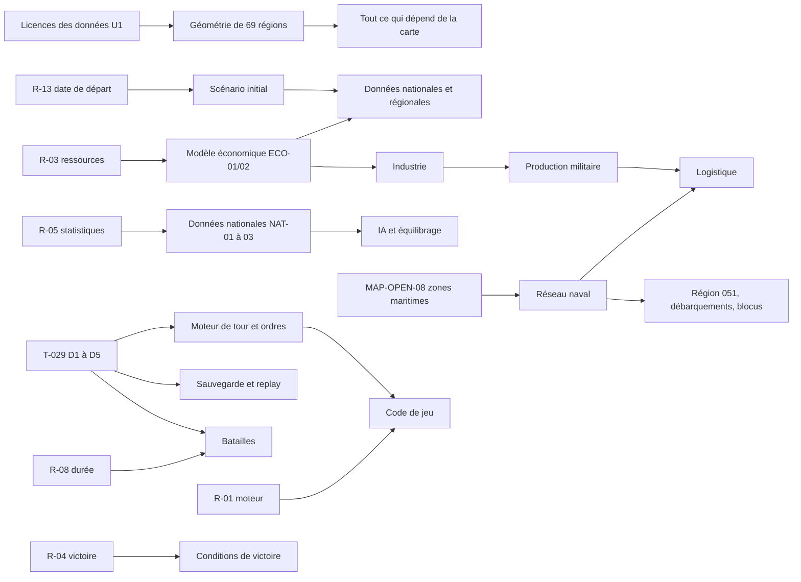

# Livrable 3 — Registre consolidé des contradictions et des décisions D-001 à D-030

- **Statut :** **ANALYSE ET PROPOSITIONS.** Aucun statut officiel n'est modifié. Les « propositions » ci-dessous n'ont aucune valeur de décision tant que le directeur ne les a pas tranchées (questionnaire : `QUESTIONS_DIRECTEUR.md`).
- **Sources :** lignée du 31/10 (`docs/legacy/oct31/PROJECT.md` §20.1, `docs/founding-document-v0.1.md`, ADR) ; lignée de référence (`PROJECT.md` v1.1, `docs/decisions/DECISIONS_PENDING.md`, `docs/*/OVERVIEW.md`, `docs/nations/PLAYABLE_POWERS.md`) ; dossier de reprise du directeur du 14/11/2026 (désigné « dossier »).

## 0. Chronologie

| Date (2026) | Commit | Lignée | Contenu |
|---|---|---|---|
| 31/10 21:20 | `459375a` | A | Infrastructure documentaire ; D-001 (première version) |
| 31/10 23:30 | `a2e0940` | A | Intégration du **document fondateur** ; D-001 révisée, D-002 à D-029 |
| 31/10 23:59 | `1ec985f` | A | D-030 (nom du jeu) ; `origin/main` |
| 01/11 00:26 | `2a341d1` | A | Dossier T-029 (document de travail) |
| 01/11 01:14 | `88e3b45`, `cdd3ab1` | A | Prototype Python ; ADR-0006 |
| 01/11 14:24 | `5d8579f` | B | « Dossier initial » v1.1 extrait (`PROJECT.md`, domaines, architecture Godot) ; **aucun identifiant D-xxx** |
| 01/11 16:16 | `fc01357` | B | 69 décisions cartographiques validées |
| 14/11 | — | (directeur) | Dossier de reprise, l'énoncé le plus récent du directeur |

**Règle d'analyse :** la date seule ne tranche rien. Le texte de la lignée B (`PROJECT.md` v1.1) provient d'un corpus remis par le directeur le 01/11. Le dossier du 14/11 est son énoncé le plus récent. Ce sont des **indices forts**, qu'il faut lui faire **confirmer**.

## 1. Fiches

### R-01 — Pile technique : ADR-0006 (Python) face à la proposition Godot
- **Documents :** `docs/decisions/0006-pile-technique-mvp.md` (`cdd3ab1`, « accepté, délégation du 31/10 ») ; `docs/architecture/TECHNICAL_ARCHITECTURE.md` (`5d8579f`, « PROPOSITION ») ; `PROJECT.md` §18–19 (gel du gameplay).
- **A :** Python 3.12 en bibliothèque standard, interface web, pour un MVP jouable.
- **B :** Godot 4.7.2 et GDScript typé, simulation séparée ; aucun code de jeu sans autorisation.
- **Chronologie :** A le 01/11 à 01:14 ; B le 01/11 à 14:24 ; orientation du directeur le 14/11 (Godot candidat privilégié, prototype gelé comme référence d'étude, décision différée).
- **Conséquences :**
  - gameplay : aucune tant que GATE-01 s'applique ;
  - technique : toute la base de code future ;
  - carto et économie : aucune (la chaîne de données reste en Python).
- **Déjà tranché :** prototype gelé, non fusionné, non poursuivi (14/11).
- **Ambigu :** moteur définitif.
- **Options :** (a) Godot ; (b) Python ; (c) hybride (simulation Python sans interface et client Godot).
- **Recommandation :** mesurer avec les prototypes neutres NP-1 à NP-6 (livrable 5), puis rédiger une ADR-0007 comparative qui « remplace » formellement 0006.
- **Question :** « Autorisez-vous les prototypes neutres NP-1 à NP-6 et l'installation de Godot 4.7.2, en vue d'une ADR-0007 soumise à votre décision ? »

### R-02 — ADR-0003 « report du choix de pile », toujours « accepté »
- **Documents :** `0003-report-du-choix-de-pile-technique.md` (`a2e0940` ou antérieur).
- **A :** choix différé. **B :** une proposition existe (Godot).
- **Conséquences :** formelles uniquement.
- **Déjà tranché :** une ADR acceptée est immuable ; seul un remplacement est possible.
- **Recommandation :** marquer 0003 « remplacé par 0007 » lors de la décision R-01.
- **Question :** aucune, elle découle de R-01.

### R-03 — Sens de « trois ressources »
- **Documents :** fondateur §9.1 et D-018 (`a2e0940`) ; `PROJECT.md` §10 (B) ; dossier §6.2–6.3.
- **A :** « Chaque territoire produit trois ressources », en quantités faible, moyenne et forte (principe inspiré de Catan) ; liste à définir.
- **B :** trois ressources principales, nourriture, matières premières (catégorie agrégée) et richesse ; stock national centralisé.
- **Dossier :** distinguer présence géologique, potentiel exploitable et production de 1914.
- **Analyse :** contradiction **apparente**. Lecture conciliante : chaque région produit les trois types de B, chacun à un niveau propre, et le potentiel naturel détaille les « matières premières ». La seule divergence réelle concerne l'**obligation** de A (une ressource faible, une moyenne, une forte par région), qui contredit une base historique sourcée.
- **Conséquences :**
  - gameplay : équilibre régional ;
  - technique : schéma des données économiques (ECO-01/02) ;
  - données : structure du futur jeu de données régional.
- **Déjà tranché :** les trois types (B, dossier).
- **Ambigu :** la règle « faible, moyenne, forte » de A est-elle maintenue ?
- **Options :** (a) niveaux libres issus des sources ; (b) contrainte « une faible, une moyenne, une forte » ; (c) niveaux sourcés puis normalisés en trois paliers.
- **Recommandation :** (c), qui concilie la lisibilité de A avec le réalisme de B et du dossier.
- **Question :** « Chaque région produit-elle les trois ressources (nourriture, matières premières, richesse) à des niveaux tirés des sources historiques, éventuellement regroupés en paliers, sans l'obligation "une faible, une moyenne, une forte" de D-018 ? »

### R-04 — Victoire « diplomatique » ou « collective »
- **Documents :** fondateur §13.2, D-025 (`a2e0940`) ; `PROJECT.md` §17 (B) ; dossier §13.
- **A :** victoire territoriale (« conquérir l'Europe »), **diplomatique** (« dominer politiquement le continent ») et économique et sociale.
- **B / dossier :** territoriale (contrôle militaire ≥ 90 %), socio-économique (IDH relatif), **collective** (traité signé par tous).
- **Analyse :** contradiction **réelle**. La domination diplomatique (un vainqueur) n'est pas un accord collectif (une issue commune).
- **Conséquences :**
  - gameplay : objectifs de l'IA, fin de partie ;
  - technique : conditions de victoire ;
  - carto : aucune.
- **Déjà tranché :** les seuils territoriaux (MAP-DEC-13).
- **Options :** (a) B remplace D-025 ; (b) ajouter une quatrième voie, diplomatique ; (c) fusionner.
- **Recommandation :** (a), cohérent avec le dossier.
- **Question :** « La victoire collective (traité signé par tous) remplace-t-elle la "victoire diplomatique" de D-025 ? »

### R-05 — Douze statistiques notées de 1 à 10 (D-027)
- **Documents :** D-027 (`a2e0940`, « décision du propriétaire », source `docs/nations/nations.md` de A, conservé dans `docs/legacy/oct31/` après l'alignement de `main`) ; `PROJECT.md` §5 (B) ; `PLAYABLE_POWERS.md` §1 (B) ; NAT-01 et NAT-04.
- **A :** échelle de 1 à 10, relative aux sept puissances.
- **B :** « Les notes comparatives précédemment proposées sont provisoires… Ne pas les traiter comme des valeurs officielles » ; échelles « À DÉFINIR ».
- **Analyse :** réelle, mais B **déclasse explicitement** les notes. Le déclassement porte sur les valeurs ; l'échelle de 1 à 10 elle-même n'est ni reprise ni rejetée.
- **Conséquences :**
  - gameplay : lisibilité, équilibre ;
  - technique : schéma NAT ;
  - données : toute la phase de données nationales.
- **Options :** (a) garder l'échelle de 1 à 10, valeurs à recalculer ; (b) valeurs physiques (unités réelles) avec affichage dérivé ; (c) les deux (stockage physique, affichage 1–10).
- **Recommandation :** (c), qui sépare la donnée historique sourcée de sa présentation.
- **Question :** « Les statistiques sont-elles stockées en unités historiques réelles et affichées sur une échelle de 1 à 10 calculée, les anciennes notes restant non officielles ? »

### R-06 — Allemagne sans empire colonial exploitable (D-028) — **apparente, résolue**
- **Documents :** D-028 (A) ; `docs/nations/PLAYABLE_POWERS.md:44` (B) : « Simplification de conception validée : l'Allemagne est traitée comme ne disposant pas d'un empire colonial exploitable… ».
- **Analyse :** les deux lignées concordent. Le rapport de phase 1 l'a classée à tort comme contradiction (erratum ajouté).
- **Question :** aucune.

### R-07 — Relations limitées à amitié, neutralité, hostilité (D-010)
- **Documents :** D-010 (A) ; `docs/diplomacy/OVERVIEW.md` §3 (B), DIP-01 « échelles À DÉFINIR ».
- **Analyse :** **lacune** de B, sans contradiction frontale. B demande de ne pas réduire les relations à une amitié permanente.
- **Options :** (a) reprendre D-010 comme catégories affichées sur une valeur continue ; (b) abandonner.
- **Recommandation :** (a), comme candidate pour DIP-01.
- **Question :** « D-010 (trois catégories de relations) reste-t-elle valable comme présentation de DIP-01 ? »

### R-08 — Durée de bataille : 30 minutes « maximum » ou « envisagées »
- **Documents :** D-014 (A) ; `PROJECT.md` l. 276 et MIL-06 (B) ; dossier §8.3 (« doivent se terminer en trente minutes maximum »).
- **Analyse :** statut affaibli dans B ; le dossier rétablit la formulation ferme.
- **Lien :** T-029 (D1 à D3).
- **Recommandation :** considérer D-014 confirmée par le dossier.
- **Question :** « La durée maximale de 30 minutes est-elle une décision ferme ? »

### R-09 — Interception exacte, pas de faux messages (D-023)
- **Documents :** D-023 (A) ; `docs/intelligence/OVERVIEW.md` §4 et INT-02 (B), mécanique « À DÉFINIR ».
- **Analyse :** lacune de B.
- **Conséquences :** sur l'IA (désinformation) et le renseignement.
- **Recommandation :** retenir D-023 comme contrainte d'INT-02.
- **Question :** « D-023 s'applique-t-elle toujours (une interception révèle le message réel, sans faux messages) ? »

### R-10 — « Province » ou « région »
- **Documents :** fondateur §4.2, `PROJECT.md` §6 (« provinces ») ; atlas, MAP-OPEN-14 et dossier (« régions »).
- **Analyse :** terminologique.
- **Recommandation (technique) :** glossaire « région = unité territoriale indivisible du jeu (anciennement province) ».
- **Question :** aucune (MAP-OPEN-14 peut être clos par le directeur lors d'une confirmation groupée).

### R-11 — Chemin `GrandStrategy` (D-030)
- **Analyse :** information obsolète ; le nom du jeu n'est pas en cause.
- **Traitement :** documentaire. Aucune question.

### R-12 — Identifiants C-01 à C-18 (revue v0.1) sans correspondance avec ceux de B
- **Traitement technique :** table de concordance C-xx ↔ MAP-OPEN, NAT, TURN, ECO, MIL, DIP, INT (à produire).
- **Question :** aucune.

### R-13 — Mois de départ de la campagne (**nouvelle**)
- **Documents :** fondateur §3.1 (« Le jeu commence en 1914 ») ; atlas (`reference_date` 1914-01-01) ; prototype (`config.start` : juin 1914, événement Sarajevo) ; dossier §1.3 et §2.2.
- **Analyse :** **non décidé**. L'atlas au 1/1/1914 décrit les frontières, qui sont identiques jusqu'à l'été 1914 pour les 90 régions, à l'exception des détails albanais (gouvernement de Vlora, puis Durrës en mars 1914).
- **Conséquences :**
  - gameplay : crise de juillet, mobilisations, événements ;
  - données : date de référence des armées, budgets et alliances ;
  - carto : quasi nulle.
- **Options :** (a) janvier 1914 ; (b) juin 1914 (veille de Sarajevo) ; (c) date paramétrable.
- **Recommandation :** aucune, c'est un choix d'expérience de jeu. Il faut seulement fixer la **date de référence des données** avant la phase de données.
- **Question :** « À quelle date commence la campagne, et à quelle date se rapportent les données nationales de départ ? »

### R-14 — Piliers du jeu (**nouvelle, mineure**)
- **Documents :** fondateur §2.1 (« la diplomatie et la stratégie militaire constituent les deux piliers principaux ») ; `PROJECT.md` et dossier §1.3 (trois piliers : profondeur, IA crédible, réalisme).
- **Analyse :** reformulation, sans conflit opérationnel.
- **Recommandation :** les trois piliers de B font référence ; D-007 reste un principe de priorité de contenu.
- **Question :** confirmation groupée.

## 2. Décisions D-001 à D-030 — statut proposé (analyse)

Légende :
- **R** : reprise sans changement ;
- **Rp** : remplacée ;
- **D** : à rediscuter ;
- **L** : lacune de la lignée de référence ;
- **NI** : historiquement acceptée, non implémentée (toutes le sont).

| ID | Objet (abrégé) | Statut proposé | Correspondance dans la lignée de référence |
|---|---|---|---|
| D-001 | Grande stratégie à partir de 1914 ; inspirations | R | `PROJECT.md` §1 |
| D-002 | Le joueur est le dirigeant suprême | R | §1 |
| D-003 | Nations indépendantes, humaines ou IA | R | §1, §16 |
| D-004 | Départ en 1914, histoire divergente | R (année) ; **mois : R-13** | §1, §17 |
| D-005 | Sept puissances jouables | R | §4 |
| D-006 | Un tour = un mois ; résolution simultanée | R | §7, TURN-02 |
| D-007 | Diplomatie et militaire comme piliers principaux | D (R-14) | §2 |
| D-008 | Diplomatie libre et confidentielle ; interception possible | R | §9, §15 |
| D-009 | Accords contraignants ou fondés sur la confiance | L | DIP-02 À DÉFINIR |
| D-010 | Relations : amitié, neutralité, hostilité | L (R-07) | DIP-01 |
| D-011 | IA autonomes, mémoire, mensonge, non omniscientes | R | §16 |
| D-012 | Armées sur la carte stratégique | R | §12 |
| D-013 | Fronts statiques sur la carte stratégique ; offensive → bataille tactique | R | §12 |
| D-014 | Batailles « Lines of Battle », 30 minutes maximum, effectifs proportionnels | D (R-08) | MIL-06 |
| D-015 | Le vainqueur occupe ; pertes définitives | R | MIL-07 |
| D-016 | Ni moral, ni généraux, ni chaîne de commandement | R | dossier §8.6 |
| D-017 | Fortifications constructibles, à niveaux | R | MAP-DEC-10, MIL-08 |
| D-018 | Trois ressources par territoire (faible, moyenne, forte) | D (R-03) | §10, ECO-01 |
| D-019 | Économie lisible | R | §10 |
| D-020 | L'industrie influence la puissance | R | §11 |
| D-021 | Recherche 1914–1945 ; avance coûteuse | R | §14 |
| D-022 | Renseignement classique ; pas de sabotage | R | §15, dossier §11.4 |
| D-023 | Interception exacte, pas de faux messages | L (R-09) | INT-02 |
| D-024 | Politique intérieure secondaire mais réelle | R | §13 |
| D-025 | Trois voies de victoire (dont « diplomatique ») | Rp (R-04) | §17 |
| D-026 | Multijoueur anticipé, pas en V1 | R | §18 |
| D-027 | Douze statistiques de 1 à 10 | Rp ou D (R-05) | NAT-01, NAT-04 |
| D-028 | Colonies simplifiées ; Allemagne sans colonies exploitables | R (R-06) | §3, `PLAYABLE_POWERS.md` |
| D-029 | Ambitions initiales qui orientent l'IA | R | `PLAYABLE_POWERS.md` (« priorités initiales ») |
| D-030 | Nom « Grand Strategy-1914 » | R (le chemin seul est obsolète : R-11) | — |

**Ce que ce tableau ne fait pas :** il ne modifie aucun statut. D-001 à D-030 restent ce qu'elles sont dans `docs/legacy/oct31/PROJECT.md`.

## 3. Graphe des dépendances

**Ordre de résolution recommandé** (par effet de déblocage) :
1. U1 (licences) ;
2. R-13, R-03, R-05 (préalables à toute collecte de données) ;
3. MAP-OPEN-08 (réseau naval) ;
4. T-029 et R-08 (architecture du tour et des batailles) ;
5. R-01 (moteur, après les mesures) ;
6. R-04, R-07, R-09, R-14 (sans blocage technique immédiat).

**Ce qui ne bloque pas le travail technique immédiat :** R-02, R-06, R-10, R-11, R-12.
